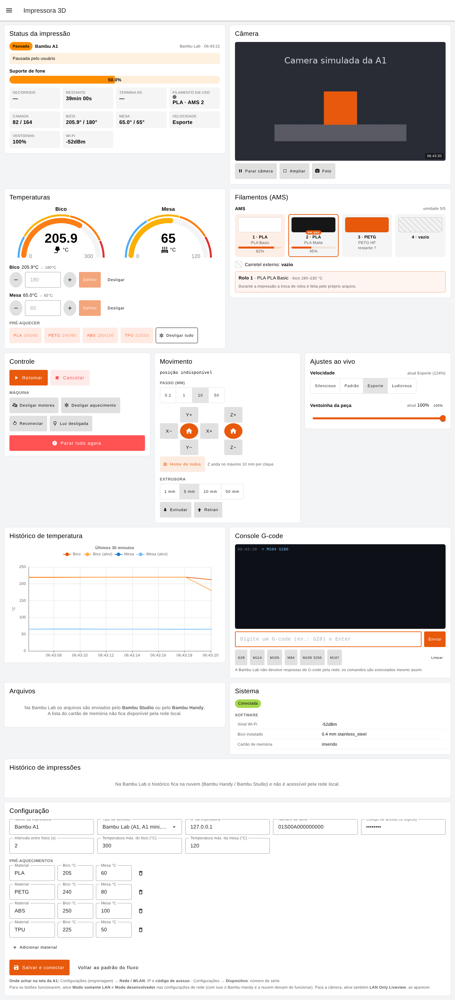

# Impressora 3D no Node-RED Dashboard

Aba **Impressora 3D** para o [Node-RED Dashboard 2](https://dashboard.flowfuse.com/) (`@flowfuse/node-red-dashboard`).
Monitora e controla impressoras **Bambu Lab** (A1, A1 mini, P1, X1, com AMS / AMS Lite), **Klipper** (Moonraker / Mainsail / Fluidd) ou **OctoPrint**.



Arquivo para importar: **[`impressora-3d.json`](impressora-3d.json)**

## O que tem na aba

| Grupo | O que mostra / faz |
|---|---|
| Status da impressão | estado, arquivo, miniatura, % concluído, tempo decorrido e restante, hora prevista de término, estimativa do fatiador, camada atual/total, altura Z, filamento usado (m e g), temperaturas, sensores extras (câmara, Raspberry…), velocidade real, vazão (mm³/s), ventoinha, velocidade/fluxo |
| Câmera | fotos a cada N s passando pelo Node-RED (funciona fora de casa) ou vídeo direto; ampliar em tela cheia; salvar foto |
| Filamentos (AMS) | os 4 rolos do AMS / AMS Lite com cor, tipo, marca, % restante e qual está em uso; dar um **nome/etiqueta e uma observação** a cada rolo, informar tipo e cor para a impressora (rolos sem RFID), carregar ou descarregar (Bambu Lab) |
| Temperaturas | medidores do bico e da mesa, definir alvo, ±5 °C, desligar, pré-aquecimento por material (PLA, PETG, ABS, TPU, editáveis) |
| Histórico de temperatura | gráfico dos últimos 30 min (bico, mesa, alvos e sensores extras) |
| Controle | pausar, retomar, cancelar (com confirmação), desligar motores, desligar aquecimento, reiniciar firmware / reconectar, parada de emergência |
| Movimento | posição X/Y/Z, eixos com home, passo 0,1 / 1 / 10 / 50 mm, home XY/Z/todos, extrudar/retrair (bloqueado com bico frio e durante a impressão) |
| Ajustes ao vivo | velocidade %, fluxo %, ventoinha %, ajuste fino de Z (babystep) com offset atual |
| Arquivos | lista com busca, pasta, tamanho, data e tempo estimado; imprimir com confirmação |
| Console G-code | envia comandos (com histórico ↑/↓), atalhos (G28, M114…), mostra as respostas da impressora |
| Histórico de impressões | totais (nº de impressões, horas, filamento, maior impressão), taxa de sucesso, últimas 30 impressões, reimprimir |
| Sistema | conexão e latência, CPU, memória, temperatura e uptime do computador da impressora, versões |
| Configuração | tipo, endereço, chave de API, câmera, temperaturas máximas e materiais, sem abrir o editor |

**Avisos automáticos** (na tela e no link `Alertas da impressora 3D`): impressão iniciada, pausada, retomada, 50 %, 90 %,
concluída, cancelada, erro, bico/mesa aquecidos, conexão perdida e restabelecida.
Ligue esse link a um nó de Telegram, e-mail, Pushover etc. para receber no celular.

## Bambu Lab A1 (e A1 mini, P1, X1)

O fluxo conversa com a impressora pela rede local, sem passar pela nuvem:

- **Dados e comandos:** MQTT com TLS na porta 8883 (usuário `bblp`, senha = código de acesso).
- **Câmera:** porta 6000 (protocolo próprio da A1/P1), repassada pelo Node-RED.

Na tela da impressora você encontra:

- **IP e código de acesso:** Configurações → Rede (WLAN).
- **Número de série:** Configurações → Dispositivo.

Para os **botões** funcionarem (pausar, temperaturas, luz, AMS…), firmwares recentes exigem
**Modo somente LAN** + **Modo desenvolvedor** ligados. Com isso o Bambu Handy e o acesso pela nuvem param de funcionar.
Para a câmera, ligue também **LAN Only Liveview** (quando existir no seu firmware).

Na Bambu não existem pela rede local: lista de arquivos, histórico de impressões, posição dos eixos, fluxo e babystep.
Para mandar arquivos continue usando o Bambu Studio ou o Bambu Handy.

> Com OctoPrint não há posição, ventoinha, velocidade, camadas nem histórico (a API REST não fornece). Os botões funcionam normalmente.

## Instalação

1. No Node-RED: **Menu → Gerenciar paleta → Instalar** → `@flowfuse/node-red-dashboard`.
2. **Menu → Importar** → cole o conteúdo de `impressora-3d.json` → **Importar** → **Deploy**.
3. Abra `http://SEU-NODE-RED:1880/dashboard/impressora-3d`.
4. No grupo **Configuração** (fim da página) escolha o tipo, preencha os dados e clique **Salvar e conectar**.
   - Bambu Lab: IP, número de série e código de acesso (veja a seção acima).
   - Klipper: `http://IP-DA-IMPRESSORA:7125` (ou o endereço do Mainsail/Fluidd).
   - OctoPrint: `http://IP-DO-OCTOPRINT` e uma chave em *Configurações → Application Keys*.

Também dá para preencher direto no nó **⚙️ Configuração** (objeto `PADRAO`).

### Se você já usa o Dashboard 2

O fluxo traz o próprio `ui-base` ("Dashboard"). Depois de importar, abra a página **Impressora 3D**
(barra lateral → Dashboard 2 → página), troque o **UI** para o seu dashboard e apague o `ui-base` duplicado.
Faça o mesmo no nó **Avisos na tela** (notificação).

### Para a configuração salva pelo dashboard sobreviver a reinícios

Ative o armazenamento de contexto em arquivo no `settings.js`:

```js
contextStorage: { default: { module: 'localfilesystem' } },
```

Sem isso, após reiniciar o Node-RED vale o que está no nó ⚙️ Configuração.

## Como funciona

- A cada 2 s o fluxo lê estado, temperaturas e posição. A cada 30 s lê arquivos, histórico e sistema.
- **Interpretar respostas** converte Moonraker e OctoPrint para o mesmo formato (`flow.estado`), usado por todas as telas.
- **Comandos** traduz cada botão para a API certa (G-code via `/printer/gcode/script` no Klipper, `/api/printer/command` no OctoPrint).
  Movimento, home e extrusão ficam bloqueados enquanto imprime.
- A foto da câmera e a miniatura passam pelos endpoints `/impressora3d/webcam` e `/impressora3d/miniatura` do Node-RED.
  Por isso funcionam mesmo acessando o dashboard de fora de casa, e a chave de API não vai para o navegador.

## Editar o código

O JSON é gerado a partir de `src/` (`funcoes/*.js` = nós function, `telas/*.vue` = ui-template):

```sh
node build.cjs          # gera impressora-3d.json
```

Para testar sem impressora:

```sh
node teste/simulador-moonraker.cjs   # Klipper simulado em http://127.0.0.1:7125
node teste/simulador-octoprint.cjs   # OctoPrint simulado em http://127.0.0.1:5000 (chave: teste)
npm install aedes && node teste/simulador-bambu.cjs
# Bambu A1 simulada: IP 127.0.0.1 · série 01S00A000000000 · código 12345678
```
